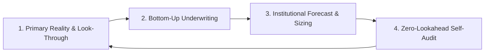

<div align="center">
  
  <h1>Investment OS</h1>
  <p><strong>An audited, strictly read-only Personal CIO workstation for Google Antigravity.</strong></p>
  <p>
    
    
    
    
    
  </p>
</div>

Investment OS turns Antigravity into a calm, local-first Quantamental CIO desk inside an interactive 6-tab MCP App sidecar (`ui://investment-os/v8/dashboard.html`). It pairs institutional portfolio math and zero-key SEC signal ingestion with transparent, self-verifying underwriting so long-only investors can compound capital without hidden concentration, cross-border tax leakage, narrative bias, or curve-fitted models.

---

## The 4-Pillar Closed Loop



### 1. Primary Reality & Signal Hygiene (`Overview`, `Holdings`, `SEC & Alerts`)
- **True Single-Name Exposure:** Dissolves ETFs via constituent look-through weights alongside direct multi-currency equities and external/employer equity (RSUs/options) while separating urgent breaches from routine noise.
- **Zero-Key Filing & Insider Pipeline:** Pulls official SEC XBRL `companyfacts` (`16Q + 5FY`) for Owner Earnings (`FCF - SBC`), ROIC, Incremental ROIC, Sloan Accruals, and Quality Grades (`A`–`D`), plus incremental Form 4 discretionary vs. 10b5-1 insider tracking (`sync_fundamentals_xbrl`, `sync_insiders_form4`).
- **Cross-Border Tax & Quiet Watchdog:** Models dividend withholding, optional IRC §2101(c) US Non-Resident Alien estate tax drag (`hedge` vs. `amortized`) and UCITS swap queues, plus delta-only alerts (`run_watchdog_sweep`, `check_sec_edgar`) that archive routine `8-K:5.02` notices out of Overview.

### 2. Bottom-Up Fundamental Underwriting (`Research`)
- **Multi-Segment SOTP Workbench (`sotp.ts`):** Builds 1–8 segment driver models (`unit_economics`, `cagr_margin`, `milestone_option`) with share-count dilution, net cash bridges, live interactive sensitivity sliders, GIGO guardrails, and automatic Bear/Base/Bull coupling (`upsert_dossier`).
- **Variant Perception & 3-Lens Deep Dives:** Maps your specific KPI differences against Street consensus straight to machine-checkable falsifiable hypotheses (`is_core`, automated XBRL/EDGAR/Form 4 rules, and anti-softening warnings), backed by Layer-1 Shared Themes (`upsert_theme`) and background 3-lens side-agent deep research.
- **Reverse DCF Expectations Bridge:** Decomposes market-implied return into `Multiple` + `Margin` + `Residual Revenue CAGR` against 5-year historical valuation bands (`P/E`, `P/FCF`, `P/S`).

### 3. Institutional Forecast & Risk Engine (`Forecast`)
- **Dynamic Shrinkage & Fat-Tail Blocks (`quant_sota.ts`, `forecast.ts`):** Uses exact analytical Ledoit-Wolf constant-correlation shrinkage (`λ*`) and automatic Patton-Politis-White spectral block length (`L*`) in a seeded 1,500-path Stationary Block Bootstrap simulator (auto-falling back to correlated Student-t `df=6` on short histories).
- **Brier-Calibrated Black-Litterman & Factor Risk:** Shrinks subjective 5Y dossier targets toward market equilibrium (`Π = δ Σ w_mkt`) weighted by empirical hypothesis Brier accuracy and valuation warnings, and computes Jacobi PCA latent factors, Meucci Effective Bets (`N_eff`), Marginal Risk Contribution %, Quarter-Kelly, and López de Prado Hierarchical Risk Parity (HRP) weights.
- **Action Simulator (`simulate_portfolio_forecast`):** Toggle Priority Tax Swaps, Mandatory Exits, Cap Trims, and Planned Buys interactively across `1Y`–`10Y` horizons and volatility regimes with instant Before-vs-After `P10`/`P50`/`P90`, `CVaR 10%`, `Max DD P95`, tax savings, and cured caps.

### 4. Zero-Lookahead Self-Audit (`Lab`)
- **Walk-Forward Model Calibration (`run_quant_evaluation`):** Runs an expanding-window (`52w` warmup, `13w`/`26w` non-overlapping step) zero-lookahead benchmark over your actual asset histories comparing Covariance estimators (Sample vs. Fixed `0.25` vs. Analytical LW via Patton QLIKE & Vol RMSE), Tail Simulators (Block Bootstrap vs. Student-t vs. Gaussian via Kupiec POF `p`-value & Pinball Loss), and an OOS Allocation Horse Race (Current Hindsight Ref vs. causal HRP-LW vs. Inv-Vol vs. Equal-Weight net of slippage).
- **Human Judgment Scorecard & Deflated Sharpe Backtester:** Grades matured (`>= 30d`) calls by directional alpha, Brier calibration, Spearman Rank IC, and horizon-scaled Scenario Band Hit Rate (`record_thesis_test`), alongside a 5Y FX-aware portfolio-impact Backtest Lab adjusted for Bailey & López de Prado Deflated Sharpe Ratio (`DSR`) and slippage (`run_portfolio_backtest`).

> [!IMPORTANT]
> **Why Investment OS is NOT a Trading Bot**
>
> Autonomous "AI trading bots" often overfit thousands of hindsight configurations or hide lookahead bugs behind unreadable code while executing live leveraged orders. Investment OS enforces **Read-Only Sovereignty** (zero order/transfer tools), open-source deterministic math that audits its own calibration out-of-sample, and human confirmation at the broker edge.

---

## 60-Second Install

Prebuilt zero-dependency runtime bundles (`dist/server.cjs` via built-in `agy-node` and self-contained `dist/dashboard.html`) ship inside the repository—end users do **not** need to compile anything:

```bash
# Clone into Antigravity's local plugins directory
git clone https://github.com/bakzs/investment-os-plugin ~/.gemini/config/plugins/investment-os
```

Or stage only clean runtime assets from a local development checkout:

```bash
npm ci
npm run stage-plugin
```

Refresh/restart plugins in Antigravity and ask:

> *"Open my Investment OS dashboard and help me onboard or refresh my portfolio."*

---

## Privacy & Local Isolation Model

- **Strict Code vs. Data Boundary:** Immutable plugin code lives inside `${PLUGIN_ROOT}`. Every personal file (`profile.yaml`, `portfolio.json`, `etf_weights.json`, `catalysts.yaml`, `themes/`, `theses/`, `dossiers/`, `macro/`, `test_log.jsonl`, `alerts_log.jsonl`, and caches) lives strictly inside `${PLUGIN_DATA}` (`0700` dirs / `0600` files; overridable via `INVESTMENT_OS_DATA_DIR`).
- **Safe to Share & Fork:** Fresh installs contain zero holdings and boot cleanly into Onboarding / Demo Preview Mode (`MSFT` 3-segment SOTP + synthetic history showcase). Automated `npm run privacy-check` scans before commit and stage.

---

## MCP Tool Surface (`v0.8.0`)

### Agent-Facing Tools (18)

| Tool | Purpose |
| :--- | :--- |
| `open_dashboard` | Render or refresh the 6-tab MCP App sidecar (`overview`, `forecast`, `holdings`, `theses`, `edgar`, `lab`), optional live quotes, or Demo preview |
| `simulate_portfolio_forecast` | Run Analytical LW (`λ*`) + Auto Block-Length (`L*`) Monte Carlo forward forecast comparing Current Path vs. swaps, exits, trims, and buys |
| `run_quant_evaluation` | Run zero-lookahead walk-forward Covariance calibration (QLIKE), Tail calibration (Kupiec POF), and causal OOS Allocation Horse Race |
| `update_profile` | Configure `base_currency`, timezone, benchmark, tax residency flags, external equity exposure, cash reserves, and risk caps |
| `update_portfolio_positions` | Upsert or prune multi-currency positions, cash balance, accruals, and FX rates |
| `update_etf_weights` | Update ETF constituent look-through weights and domicile/OCF metadata |
| `update_external_wealth` | Update external compensation exposure (RSUs/options) or near-term reserve buffers |
| `upsert_theme` | Create or update a Layer-1 shared macro/sector theme (`themes/<slug>.{yaml,md}`) with linked stances and signposts |
| `upsert_dossier` | Atomically update a stock's thesis card, bottom-up SOTP `fundamental_model`, `variant_perception[]`, Reverse DCF, memo, and intel |
| `update_thesis` | Lightweight wrapper for updating thesis markdown, buy/trim zones, kill-switches, and hypotheses |
| `ingest_research_intel` | Persist structured read-only broker/research snapshots (`earnings_insight`, `consensus`, `themes`, `pa_performance`) + `intel_history.jsonl` |
| `sync_fundamentals_xbrl` | Pull SEC XBRL `companyfacts` (`16Q + 5FY`) and derive Owner Earnings, ROIC, Sloan Accruals, Quality Grade (`A`–`D`), and forensic ratios |
| `sync_insiders_form4` | Parse SEC Form 4 XML & Schedule 13D filings incrementally, separating discretionary insider trades from Rule 10b5-1 plans |
| `check_sec_edgar` | Poll live `data.sec.gov` filings, evaluate catalyst SEC gates, and classify 3-tier SEC red flags |
| `run_watchdog_sweep` | Run a quiet delta-only CIO Watchdog sweep across quotes, macro regime, SEC gates, XBRL rules, insiders, and risk caps |
| `record_thesis_test` | Execute and score a Red-Team hypothesis challenge, set conviction verdict, and append Point-in-Time snapshot to `test_log.jsonl` |
| `run_portfolio_backtest` | Run a 5Y FX-aware deterministic portfolio-impact backtest with correlations, slippage, weekly `CVaR 95%`, and Deflated Sharpe Ratio |
| `manage_catalysts` | Add, remove, or replace dated catalysts and binary SEC filing gates |

### App-Only UI Tools (13, `visibility: ["app"]`)

`app_get_dashboard`, `app_simulate_forecast`, `app_run_quant_eval`, `app_get_dossier_detail`, `app_get_theme_detail`, `app_save_external_wealth`, `app_save_trigger`, `app_upsert_hypothesis`, `app_save_dossier_model`, `app_check_edgar`, `app_run_watchdog`, `app_ack_alert`, and `app_run_backtest` power instant 60fps UI interactions inside the sidecar without cluttering chat.

---

## Documentation Index

- **[Vision & Product Philosophy](docs/VISION.md):** The `v0.8` 4-pillar closed loop, core principles, why this isn't a trading bot, and explicit non-goals.
- **[Architecture & Design](docs/DESIGN.md):** System topology, `${PLUGIN_ROOT}` vs. `${PLUGIN_DATA}` schema inventory, quant math, UI token system, and security model.
- **[Systematic Thesis Testing Manual](docs/THESIS_TESTING.md):** Falsification methodology, machine-checkable XBRL/EDGAR rules, Variant Perception linking, Rank IC & Brier scoring.
- **[Architecture Decision Records](docs/adr/README.md):** Core governance invariants (`Read-Only Sovereignty`, `Local Vault Isolation`, `Monochrome UI`).
- **[Changelog](CHANGELOG.md):** Full release history through `0.8.0`.
- **[Contributing Guidelines](CONTRIBUTING.md):** Development setup, automated git hooks, verification gates, and strict privacy rules.
- **[Security & Privacy Policy](SECURITY.md):** Vulnerability reporting and sandboxing guarantees.

## Development & Verification

```bash
npm ci                 # Activates .githooks/ via prepare script
npm run verify         # typecheck + build + bundle/contract checks + tests + privacy scan
npm run stage-plugin   # Stage clean runtime bundle locally for dogfooding
```

## License

MIT
