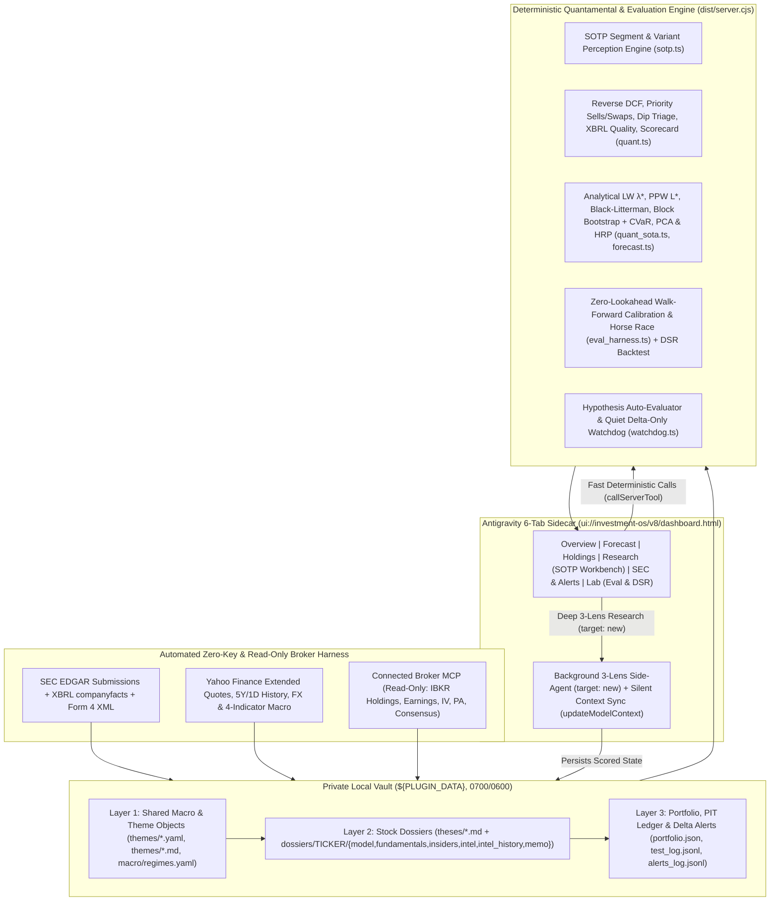

# System Architecture & Design (`v0.8`)

Investment OS is packaged as a zero-dependency **Antigravity MCP App Plugin**. All runtime logic compiles into a single Node CJS bundle (`dist/server.cjs`) paired with a single self-contained HTML application (`dist/dashboard.html`, `< 1 MB`) served over MCP Resources (`ui://investment-os/v8/dashboard.html`).

## High-Level Topology (`v0.8`)

## Runtime & Storage Isolation

Strict physical separation guarantees the repository can be publicly shared, forked, and upgraded without ever touching personal portfolio files:

| Directory | Env / Manifest Mapping | Git Tracked? | Contents & Permissions |
| :--- | :--- | :--- | :--- |
| `${PLUGIN_ROOT}` | Plugin install directory | Yes | `plugin.json`, `mcp_config.json`, `assets/`, `defaults/`, `skills/`, `dist/server.cjs`, `dist/dashboard.html`, `docs/` |
| `${PLUGIN_DATA}` | `INVESTMENT_OS_DATA_DIR` fallback | **Never** | Private vault (`0700` dirs, `0600` files) inventoried below |

### 3-Layer `${PLUGIN_DATA}` Schema Inventory

| Layer | File | Format / Schema | Managed By | Purpose |
| :--- | :--- | :--- | :--- | :--- |
| **L1** | `themes/<slug>.yaml` + `.md` | YAML (`ThemeObjectSchema`) + MD | `upsert_theme` | Shared macro/sector theses (`relationship_mode`, `shared_assumptions[]`, `exposures[]`, `signposts[]`, `sources[]`) |
| **L1** | `macro/regimes.yaml` | YAML (`MacroRegimeSchema`) | `fetchMacroRegime`, `run_watchdog_sweep` | 4-indicator macro strip (`VIX`, `US 10Y`, `3M T-Bill`, `HYG/IEF`, `DXY`, `regime_label`) |
| **L2** | `theses/<TICKER>.md` | YAML Frontmatter + MD | `update_thesis`, `upsert_dossier`, `record_thesis_test` | Tier, `action_verdict`, `takeaway[]`, `theme_refs[]`, provenance & `sources[]`, triggers, rule-backed `hypotheses[]`, kill-switches, Decision Log |
| **L2** | `dossiers/<TICKER>/model.json` | JSON (`DossierModelSchema`) | `upsert_dossier`, `app_save_dossier_model` | Bottom-up SOTP `fundamental_model` (`unit_economics`, `cagr_margin`, `milestone_option` segments, `variant_perception[]`, share dilution, net cash), Reverse DCF (`net_cash_b`, `annual_dilution_pct`), Bear/Base/Bull scenarios, `accumulating`, `dividend_wht_pct`, custom tranches |
| **L2** | `dossiers/<TICKER>/fundamentals.json` | JSON (`FundamentalsSchema`) | `sync_fundamentals_xbrl`, `run_watchdog_sweep` | 16Q + 5FY GAAP/IFRS XBRL series, Owner Earnings (`FCF − SBC`), ROIC, Incremental ROIC, Sloan Accruals, Quality Grade (`A`–`D`), `DSO`, `DIO`, `GM%`, `OCF/NI`, `SBC%`, Net Cash, TTM per-share metrics, preserved `overrides` |
| **L2** | `dossiers/<TICKER>/insiders.json` | JSON (`InsidersSchema`) | `sync_insiders_form4`, `run_watchdog_sweep` | Incremental Form 4 & SC 13D/13D-A aggregation (90D/12M discretionary vs. 10b5-1 buys/sales, C-suite cluster flags) |
| **L2** | `dossiers/<TICKER>/intel.json` + `intel_history.jsonl` | JSON + Append-only JSONL | `ingest_research_intel`, `upsert_dossier` | Broker earnings insights, ATM straddle implied move & IV skew, consensus estimates/revisions, themes, connections, plus historical numeric snapshots |
| **L2** | `dossiers/<TICKER>/memo.md` | Markdown | `upsert_dossier` | Primary-source research memo lazy-loaded inside `#stock-inspector` |
| **L3** | `profile.yaml` | YAML (`ProfileSchema`) | `update_profile`, `update_external_wealth` | Base currency, timezone, benchmark & estate-tax drag mode (`hedge` vs. `amortized`), tax profile, external equity (`amount_base` or live `qty`), cash reserve, risk caps |
| **L3** | `portfolio.json` | JSON (`PortfolioSchema`) | `update_portfolio_positions` | Multi-currency positions, cash/accruals, FX rates, snapshot timestamp |
| **L3** | `etf_weights.json` | JSON (`EtfWeightsConfigSchema`) | `update_etf_weights` | Zod-validated ETF look-through constituent maps and residual metadata |
| **L3** | `catalysts.yaml` | YAML (`CatalystsFileSchema`) | `manage_catalysts` | Dated catalyst milestones and SEC form gate definitions |
| **L3** | `test_log.jsonl` | Append-only JSONL (`ThesisTestRecordSchema`) | `record_thesis_test`, `saveOrMergeThesis`, `app_save_dossier_model` | Immutable chronological ledger of `thesis_test` (with `pit_snapshot`, `benchmark_price_at_test`, and expected Bear/Base/Bull range) and `rule_change` audit events |
| **L3** | `alerts_log.jsonl` | Append-only JSONL (`WatchdogAlertSchema`) | `run_watchdog_sweep`, `app_ack_alert` | Delta-only CIO Watchdog alerts (SEC gate clears, 8-K/NT red flags, XBRL breaches, re-entry hits, audit drift, insider signals, cap breaches) |
| **L3** | `market_cache.json` / `history_cache.json` / `edgar_latest.json` / `pa_performance.json` | Validated JSON caches | Server & Signal Harness | Extended quotes + persisted FX + macro cache; 5Y weekly + FX (`EURUSD=X`) + daily benchmark (`daily:<SYM>`) history; 4 periodic + 10 event SEC filings per ticker; broker PA TWR/MWR |

## MCP Tool Architecture (`v0.8` — 31 Tools Total)

All tools are **strictly read-only** with respect to brokerage execution (enforced in CI by `scripts/verify-bundle.mjs`):

1. **Agent + UI Tools (18 tools — `visibility: ["model", "app"]`, `resourceUri: "ui://investment-os/v8/dashboard.html"`):**
   - `open_dashboard`, `simulate_portfolio_forecast`, `run_quant_evaluation`, `update_profile`, `update_portfolio_positions`, `update_etf_weights`, `update_external_wealth`, `update_thesis`, `upsert_dossier`, `upsert_theme`, `ingest_research_intel`, `sync_fundamentals_xbrl`, `sync_insiders_form4`, `run_watchdog_sweep`, `run_portfolio_backtest`, `manage_catalysts`, `check_sec_edgar`, `record_thesis_test`.
2. **App-Only UI Tools (13 tools — `visibility: ["app"]`):**
   - `app_get_dashboard`, `app_simulate_forecast`, `app_run_quant_eval`, `app_check_edgar`, `app_run_watchdog`, `app_get_theme_detail`, `app_ack_alert`, `app_save_external_wealth`, `app_save_trigger`, `app_upsert_hypothesis`, `app_get_dossier_detail`, `app_save_dossier_model`, `app_run_backtest`.

## Background Side-Agent UX Pattern

Interactive research actions inside the sidecar (`Deep Research`, `Systematic Test`, `Build SOTP Model with Agent`) never interrupt the user's active conversation by default:

1. **Fast Deterministic Actions** (Refresh Live, Run Forecast, Run Quant Eval, Live SOTP Sliders, Save Model, Run Backtest, Watchdog, Ack Alert) execute locally or directly against the MCP server via `app.callServerTool(...)` with zero chat turns.
2. **Deep Agent Audits** default to `mode: "background"`, invoking `app.sendMessage({ role: "user", content: [...], _meta: { "com.google.antigravity/message": { target: "new" } } })` and immediately calling `app.updateModelContext(...)` so the main conversation learns about the background run passively on the next turn.
3. **Explicit Main-Thread Escalation:** Switching the segmented control to **This Chat** routes any research dispatch into the current conversation when the user actively wants to debate a thesis inline.

## Quantitative Financial & Evaluation Engine

1. **Bottom-Up Multi-Segment SOTP & Variant Perception (`src/server/sotp.ts`):**
   - Models 1–8 segments per stock using three deterministic engines (`unit_economics`, `cagr_margin`, `milestone_option`), projects Year-`T` diluted shares and net cash, optionally auto-derives `scenarios.{bear,base,bull}` (`derive_scenarios_from_sotp: true`), checks Bear ≤ Base ≤ Bull ordering + GIGO sanity guardrails (XBRL TTM revenue divergence, share-count mismatch, `>$5T` equity cap, option concentration), and supports instant 60fps client-side slider sensitivity + explicit detach overrides inside `#stock-inspector`.
2. **Analytical Shrinkage, Automatic Block Length & Black-Litterman Forecast (`src/server/{quant_sota,forecast}.ts`):**
   - Replaces static constants with exact **Analytical Ledoit & Wolf (2004)** constant-correlation shrinkage (`λ*`) over canonical-deduplicated risky-asset weekly returns (with PSD eigenvalue projection `< 1e-10`) and **Patton-Politis-White (2009)** automatic spectral block length (`L*`) across returns and `|r_t - mean|` volatility clustering.
   - Blends market equilibrium implied returns (`Π = δ Σ w_mkt`) with 5Y SOTP/scenario expectations scaled by Hypothesis Brier Score and GIGO `valuation_warnings`, simulates 1,500 multivariate paths (Politis-Romano Block Bootstrap or Student-t `df=6` fallback), and decomposes risk via **Jacobi PCA**, **Meucci Effective Bets (`N_eff`)**, Marginal Risk Contribution %, Quarter-Kelly, and **López de Prado HRP** weights.
3. **Zero-Lookahead Walk-Forward Evaluation (`src/server/eval_harness.ts`):**
   - Benchmarks **Covariance** (`Sample` vs. `Fixed-0.25` vs. `Analytical LW` on unbiased `1/(T-1)` scaling via Patton QLIKE & Vol RMSE), **Tail Risk** (`Politis-White Block Bootstrap` vs. `Student-t df=6` vs. `Gaussian` via Kupiec POF `p`-value, 5% Pinball Loss, 80% coverage, and nullable `cvar95_shortfall_ratio`), and **Causal OOS Allocation** (`HRP-LW` vs. `Inv-Vol` vs. `Equal-Weight` vs. clearly disclosed `Current Weights (Hindsight Ref)`) net of transaction costs over non-overlapping `13w`/`26w` steps after a `52w` warmup.
4. **After-Tax Hurdle, Reverse DCF, Capital Rotation & Deflated Sharpe Backtest (`src/server/quant.ts`):**
   - Computes cross-border WHT + mode-selectable NRA estate tax (`hedge` vs. `amortized`), 3-part Reverse DCF attribution (`Multiple` + `Margin` + `Residual Rev`), SEC XBRL Owner Earnings/ROIC/Sloan Accruals Quality (`A`–`D`), Priority Sells & Tax Swaps paired with Dual-Headroom Dip Triage, FX-converted 5Y portfolio-impact backtests with **Deflated Sharpe Ratio (`DSR`)**, and a 30-day-matured Forward Judgment Scorecard tracking Brier calibration, `0.5Y`-damped **Spearman Rank IC**, and horizon-scaled **Scenario Band Hit Rate**.

## Security & Frontend Guardrails

- **CSP & Self-Contained Bundle:** `dist/dashboard.html` runs strictly offline (`< 1 MB` budget, zero CDN scripts/styles, `light-dark()` + `color-mix(in oklab, ...)` Slate + Indigo palette, zero banned rainbow hexes).
- **Path Containment & `0700`/`0600` Permissions:** All ticker (`TICKER_REGEX`) and theme slug (`THEME_SLUG_REGEX`) paths resolve strictly through `safeResolve` inside `DATA_DIR` with atomic `0600` writes.
- **Automated Verification Gates:** `npm run verify` runs `typecheck`, `build`, `verify-bundle`, `test`, and `privacy-check`.
