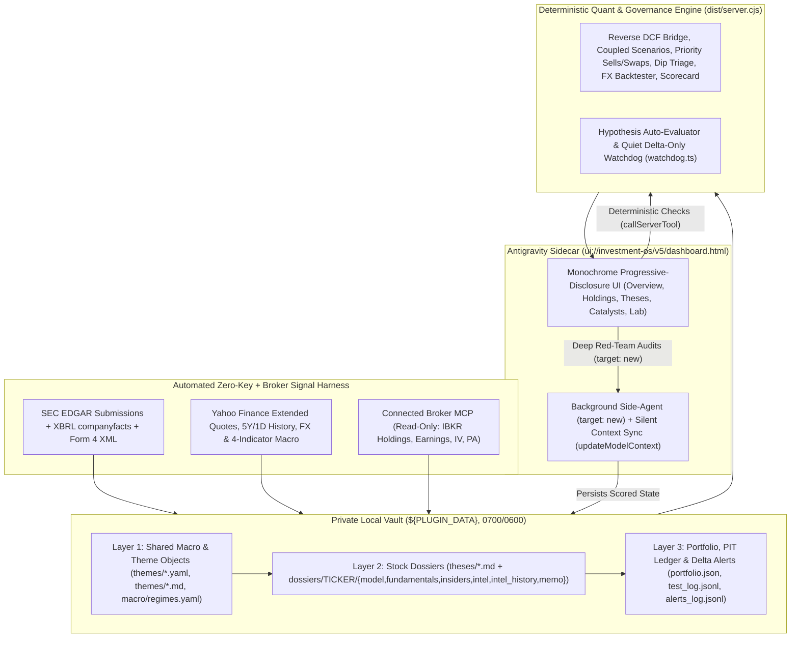

# System Architecture & Design

Investment OS is packaged as a zero-dependency **Antigravity MCP App Plugin**. All runtime logic compiles into a single Node CJS bundle (`dist/server.cjs`) paired with a single self-contained HTML application (`dist/dashboard.html`) served over MCP Resources (`ui://investment-os/v5/dashboard.html`).

## High-Level Topology (`v0.5`)

## Runtime & Storage Isolation

Strict physical separation guarantees the repository can be publicly shared, forked, and upgraded without ever touching personal portfolio files:

| Directory | Env / Manifest Mapping | Git Tracked? | Contents & Permissions |
| :--- | :--- | :--- | :--- |
| `${PLUGIN_ROOT}` | Plugin install directory | Yes | `plugin.json`, `skills/`, `dist/server.cjs`, `dist/dashboard.html`, `docs/` |
| `${PLUGIN_DATA}` | `INVESTMENT_OS_DATA_DIR` fallback | **Never** | Private vault (`0700` dirs, `0600` files) inventoried below |

### 3-Layer `${PLUGIN_DATA}` Schema Inventory

| Layer | File | Format / Schema | Managed By | Purpose |
| :--- | :--- | :--- | :--- | :--- |
| **L1** | `themes/<slug>.yaml` + `.md` | YAML (`ThemeObjectSchema`) + MD | `upsert_theme` | Shared macro/sector theses (`relationship_mode`, `shared_assumptions[]`, `exposures[]`, `signposts[]`, `sources[]`) |
| **L1** | `macro/regimes.yaml` | YAML (`MacroRegimeSchema`) | `fetchMacroRegime`, `run_watchdog_sweep` | 4-indicator macro strip (`VIX`, `US 10Y`, `3M T-Bill`, `HYG/IEF`, `DXY`, `regime_label`) |
| **L2** | `theses/<TICKER>.md` | YAML Frontmatter + MD | `update_thesis`, `upsert_dossier`, `record_thesis_test` | Tier, `action_verdict`, `takeaway[]`, `theme_refs[]`, provenance & `sources[]`, triggers, rule-backed `hypotheses[]`, kill-switches, Decision Log |
| **L2** | `dossiers/<TICKER>/model.json` | JSON (`DossierModelSchema`) | `upsert_dossier`, `app_save_dossier_model` | Reverse DCF (`net_cash_b`, `annual_dilution_pct`), Bear/Base/Bull scenarios, `accumulating`, `dividend_wht_pct`, custom tranches |
| **L2** | `dossiers/<TICKER>/fundamentals.json` | JSON (`FundamentalsSchema`) | `sync_fundamentals_xbrl`, `run_watchdog_sweep` | 16Q + 5FY GAAP/IFRS XBRL series, derived forensic ratios (`DSO`, `DIO`, `GM%`, `OCF/NI`, `SBC%`, `Net Cash`, TTM per-share), preserved `overrides` |
| **L2** | `dossiers/<TICKER>/insiders.json` | JSON (`InsidersSchema`) | `sync_insiders_form4`, `run_watchdog_sweep` | Incremental Form 4 & SC 13D/13D-A aggregation (90D/12M discretionary vs. 10b5-1 buys/sales, C-suite cluster flags) |
| **L2** | `dossiers/<TICKER>/intel.json` + `intel_history.jsonl` | JSON + Append-only JSONL | `ingest_research_intel`, `upsert_dossier` | Broker earnings insights, ATM straddle implied move & IV skew, themes, connections, plus historical numeric snapshots |
| **L2** | `dossiers/<TICKER>/memo.md` | Markdown | `upsert_dossier` | Primary-source research memo lazy-loaded inside `#stock-inspector` |
| **L3** | `profile.yaml` | YAML (`ProfileSchema`) | `update_profile`, `update_external_wealth` | Base currency, timezone, benchmark & estate-tax drag mode (`hedge` vs. `amortized`), tax profile, external equity (`amount_base` or live `qty`), cash reserve, risk caps |
| **L3** | `portfolio.json` | JSON (`PortfolioSchema`) | `update_portfolio_positions` | Multi-currency positions, cash/accruals, FX rates, snapshot timestamp |
| **L3** | `etf_weights.json` | JSON (`EtfWeightsConfigSchema`) | `update_etf_weights` | Zod-validated ETF look-through constituent maps and residual metadata |
| **L3** | `catalysts.yaml` | YAML (`CatalystsFileSchema`) | `manage_catalysts` | Dated catalyst milestones and SEC form gate definitions |
| **L3** | `test_log.jsonl` | Append-only JSONL (`ThesisTestRecordSchema`) | `record_thesis_test`, `saveOrMergeThesis`, `app_save_dossier_model` | Immutable chronological ledger of `thesis_test` (with `pit_snapshot` & `benchmark_price_at_test`) and `rule_change` audit events |
| **L3** | `alerts_log.jsonl` | Append-only JSONL (`WatchdogAlertSchema`) | `run_watchdog_sweep`, `app_ack_alert` | Delta-only CIO Watchdog alerts (SEC gate clears, 8-K/NT red flags, XBRL breaches, re-entry hits, audit drift, insider signals, cap breaches) |
| **L3** | `market_cache.json` / `history_cache.json` / `edgar_latest.json` / `pa_performance.json` | Validated JSON caches | Server & Signal Harness | Extended quotes + persisted FX + macro cache; 5Y weekly + FX (`EURUSD=X`) + daily benchmark (`daily:<SYM>`) history; 4 periodic + 10 event SEC filings per ticker; broker PA TWR/MWR |

## MCP Tool Architecture (`v0.5`)

All tools are **strictly read-only** with respect to brokerage execution (enforced in CI by `scripts/verify-bundle.mjs`):

1. **Agent + UI Tools (`visibility: ["model", "app"]`, `resourceUri: "ui://investment-os/v5/dashboard.html"`):**
   - `open_dashboard`, `update_profile`, `update_portfolio_positions`, `update_etf_weights`, `update_external_wealth`, `update_thesis`, `upsert_dossier`, `upsert_theme`, `ingest_research_intel`, `sync_fundamentals_xbrl`, `sync_insiders_form4`, `run_watchdog_sweep`, `run_portfolio_backtest`, `manage_catalysts`, `check_sec_edgar`, `record_thesis_test`.
2. **App-Only UI Tools (`visibility: ["app"]`):**
   - `app_get_dashboard`, `app_check_edgar`, `app_run_watchdog`, `app_get_theme_detail`, `app_ack_alert`, `app_save_external_wealth`, `app_save_trigger`, `app_upsert_hypothesis`, `app_get_dossier_detail`, `app_save_dossier_model`, `app_run_backtest`.

## Background Side-Agent UX Pattern

Interactive research actions inside the sidecar (`Run Systematic Test`, `Refine / Challenge`, `Sync`) never interrupt the user's active conversation by default:

1. **Fast Deterministic Actions** (Refresh Live, Run Watchdog, Ack Alert, Save Trigger, Save Model, Run Backtest) execute directly against the local MCP server via `app.callServerTool(...)` with zero chat turns.
2. **Deep Agent Audits** default to `mode: "background"`, invoking `app.sendMessage({ role: "user", content: [...], _meta: { "com.google.antigravity/message": { target: "new" } } })` and immediately calling `app.updateModelContext(...)` so the main conversation learns about the background run passively on the user's next turn.
3. **Explicit Main-Thread Escalation:** A secondary **Discuss Here** button sends the prompt into the current conversation when the user actively wants to debate a thesis inline.

## Quantitative Financial Engine (`src/server/quant.ts` & `src/server/engine.ts`)

1. **After-Tax Hurdle & Coupled Scenarios:** Adds `+dividend_yield_pct` into `gross_cagr_pct` for distributing securities (`!accumulating`) before deducting dividend WHT (supporting per-dossier `dividend_wht_pct` overrides and 0 extra drag on accumulating UCITS ETFs). Supports `estate_tax_drag_mode: "hedge"` (default `35 bps/yr`) vs. `"amortized"` (`20Y`), fixes `marginalEstateRatePct === 0` exemption handling, separates expected-wealth CAGR from standalone Kelly CAGR + dispersion drag bps, and emits deterministic outside-view GIGO `valuation_warnings`.
2. **Reverse DCF 3-Part Attribution & 5Y Valuation Bands:** Adjusts EV by `net_cash_b` and terminal share count by `annual_dilution_pct`, outputting `multiple_expansion_cagr_pct`, `margin_expansion_cagr_pct`, `residual_revenue_cagr_pct`, and `constant_mult_margin_rev_cagr_pct`, paired with 5Y historical `P/E`, `P/FCF`, and `P/S` percentile bands (`p10`/`median`/`p90`).
3. **Priority Sells & Tax Swaps (`computeCapitalRotationQueue`) + Dual-Headroom Dip Triage:** Ranks US-ETF -> UCITS tax swaps (with auto-cured caps), mandatory held exits (even when `tier === "passed"`), and net cap trims. Feeds freed proceeds directly into Dip Triage alongside deployable cash, prioritizes `GATED` ahead of `CAP_BLOCKED`, exempts the benchmark ETF as `CORE_ANCHOR`, blocks `UNMODELED`/`PROBATION`/`EXIT`/kill-switch tickers from `READY`, and annotates `VIX >= 28` High-Vol Staged tranches.
4. **FX-Converted Portfolio-Impact Backtester:** Applies weekly FX conversion (`EURUSD=X`, etc.), hybrid drift rebalance band `Math.max(0.02, targetW * bandFrac)`, drops incomplete current weeks, caps carry-forward gaps at 1 week, credits cash with `rf_pct` (cached 3M T-bill or `4.0%`), reports `sharpe_se` and `rebalance_count`, and supports `include_external_wealth` (default `true`).
5. **Matured Forward Judgment Scorecard & Brier Calibration:** Marks `<30d` entries `PENDING`, deduplicates same ticker+verdict within 30 days, uses `benchmark_price_at_test` + daily benchmark history, scores directional verdict signs cleanly (`HIGH_CONVICTION`/`GO` vs. `EXIT`/`PROBATION`/`PASS` vs. `WATCH`), aggregates `90d`/`180d`/`1Y` buckets, and computes Brier calibration over resolved hypotheses.

## Security & Frontend Guardrails

- **CSP & Self-Contained Bundle:** `dist/dashboard.html` runs strictly offline (`< 1 MB` budget, zero CDN scripts/styles, `light-dark()` + `color-mix(in oklab, ...)` monochrome palette, zero banned rainbow hexes).
- **Path Containment & `0700`/`0600` Permissions:** All ticker (`TICKER_REGEX`) and theme slug (`THEME_SLUG_REGEX`) paths resolve strictly through `safeResolve` inside `DATA_DIR` with atomic `0600` writes.
- **Automated Verification Gates:** `npm run verify` runs `typecheck`, `build`, `verify-bundle`, `test`, and `privacy-check`.
