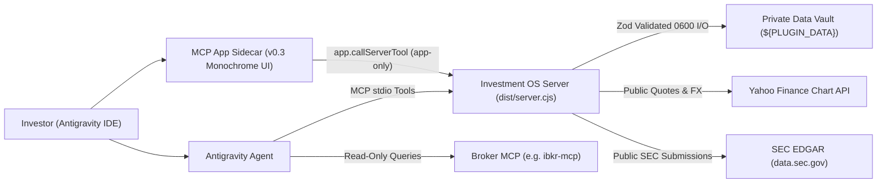

# System Architecture & Design

Investment OS is packaged as a zero-dependency **Antigravity MCP App Plugin**. All runtime logic compiles into a single Node CJS bundle (`dist/server.cjs`) paired with a single self-contained HTML application (`dist/dashboard.html`) served over MCP Resources (`ui://investment-os/v3/dashboard.html`).

## High-Level Topology

## Runtime & Storage Isolation

Strict physical separation guarantees the repository can be publicly shared, forked, and upgraded without ever touching personal portfolio files:

| Directory | Env / Manifest Mapping | Git Tracked? | Contents & Permissions |
| :--- | :--- | :--- | :--- |
| `${PLUGIN_ROOT}` | Plugin install directory | Yes | `plugin.json`, `skills/`, `dist/server.cjs`, `dist/dashboard.html`, `docs/` |
| `${PLUGIN_DATA}` | `INVESTMENT_OS_DATA_DIR` fallback | **Never** | User data (`0700` dir, `0600` files) listed below |

### `${PLUGIN_DATA}` Schema Inventory

| File | Format | Managed By | Purpose |
| :--- | :--- | :--- | :--- |
| `profile.yaml` | YAML (`ProfileSchema`) | `update_profile`, `update_external_wealth` | `base_currency`, timezone, tax settings, external exposure, cash reserve, risk cap rules |
| `portfolio.json` | JSON (`PortfolioSchema`) | `update_portfolio_positions` | Multi-currency positions, cash/accruals, manual/live FX rates, timestamp |
| `etf_weights.json` | JSON (`EtfWeightsConfig`) | User / Agent | Optional ETF underlying constituent maps (percentages) for look-through aggregation |
| `catalysts.yaml` | YAML (`CatalystsFileSchema`) | `manage_catalysts` | Dated catalyst milestones and SEC form gate definitions |
| `theses/<TICKER>.md` | YAML Frontmatter + Markdown | `update_thesis`, `record_thesis_test`, `app_*` | Buy/trim zones, verdict, bear case summary, falsifiable `hypotheses[]`, kill-switches, dated decision log |
| `test_log.jsonl` | Append-only JSON Lines | `record_thesis_test` | Immutable chronological record of hypothesis evaluations, prices at test, and verdicts |
| `market_cache.json` | JSON | Auto (`fetchLiveQuotes`) | Latest Yahoo quotes, 1D/1M deltas, 22-point sparklines, FX rates, VIX |
| `edgar_cache.json` | JSON | `check_sec_edgar`, `app_check_edgar` | Cached ticker CIKs and recent SEC form metadata (`10-K`, `10-Q`, `8-K`, `20-F`, `6-K`, `DEF 14A`) |

## MCP Tool Architecture

Tools split cleanly across two visibility tiers using `_meta.ui`:

1. **Agent + UI Tools (`visibility: ["model", "app"]`):**
   - `open_dashboard`: Computes full analytics payload and binds the interactive resource `ui://investment-os/v3/dashboard.html`.
   - `update_profile`: Upserts currency, residency tax toggles, risk cap rules, and optional external/reserve blocks.
   - `update_portfolio_positions`: Merges position batches, prunes `qty: 0`, infers default domicile/currency/US-situs heuristics, and stamps FX.
   - `update_external_wealth`: Fast incremental updates to illiquid external holdings and reserve targets.
   - `update_thesis`: Structured upsert across frontmatter targets (`buy_zone_low`, `buy_zone_high`, `trim_zone`, `gated`, `verdict`, `hypotheses`) and Markdown body sections.
   - `record_thesis_test`: Validates `ThesisTestRecordSchema`, updates hypothesis statuses/evidence, recomputes frontmatter `last_tested_date` & `bear_case_summary`, appends to the Markdown decision log, and writes a permanent line to `test_log.jsonl`.
   - `manage_catalysts`: Adds/removes/replaces binary catalysts and optional SEC form gates.
   - `check_sec_edgar`: Resolves CIKs and evaluates whether target forms (`filed_after`) have cleared on `data.sec.gov`.
2. **App-Only UI Tools (`visibility: ["app"]`):**
   - `app_get_dashboard`: Switches tabs, toggles live Yahoo quote refreshes, or toggles sandboxed in-memory Sample Demo Preview.
   - `app_save_external_wealth`: Persists slider adjustments from the Stress-Tester back into `profile.yaml`.
   - `app_save_trigger`: Persists trigger zone and gate edits from the Stock Inspector drawer into `theses/<TICKER>.md`.
   - `app_upsert_hypothesis`: Adds or updates an individual falsifiable claim directly from the Stock Inspector UI.
   - `app_check_edgar`: Triggers on-demand SEC EDGAR submission polling from the Catalysts & SEC tab.

## Quantitative Financial Engine (`src/server/engine.ts`)

1. **Currency Normalization:** Every position computes market value in its trading currency (`qty * price`), converts to USD via live or cached FX rates, and translates into `profile.base_currency` (`usd_to_base_fx`), separating trading performance from FX translation effects.
2. **Look-Through Aggregation:** For every ETF in `portfolio.json` matching an entry in `etf_weights.json`, underlying constituent USD exposure is summed alongside direct single-stock holdings. The engine outputs unified `pct_nav` and `direct_usd` vs. `via_etfs_usd` attribution.
3. **Configurable Risk Guardrails:** Rules in `profile.risk_caps` (`RiskCapRuleSchema`) support four evaluation kinds:
   - `single_name_max`: Maximum look-through NAV % of any single holding.
   - `ticker`: Portfolio look-through NAV % of a named `ticker`.
   - `bucket`: Aggregate look-through NAV % across `tickers[]` (and optional `include_etf_residual_key`), also evaluated on a total-wealth basis when paired with `external_exposure`.
   - `us_situs`: Share of portfolio NAV held in US-situs securities.
4. **Optional US NRA Estate Tax (`computeUsEstateTaxNra`):** When `tax_profile.nra_us_estate_tax_enabled` is `true`, calculates progressive statutory rates (`18%`–`40%`) after the IRC §2101(c) US\$13,000 unified credit (~US\$60,000 exemption equivalent) across US-situs assets, alongside counterfactual non-US-situs UCITS wrapper savings.

## Frontend Design System & Modern Web Compliance

- **Monochrome Surface Hierarchy:** Built strictly on semantic custom properties with `color-scheme: light dark`, `light-dark()`, and perceptual OKLab color mixing (`color-mix(in oklab, ...)`). Syncs dynamically with host Antigravity themes via `applyDocumentTheme` and `applyHostStyleVariables`.
- **Single Highlight Signal Rule:** Structural tables, sparklines, look-through stacks, and risk cap meters use neutral slate/steel tones (`--viz-1` .. `--viz-8`). Muted sage green (`--ok`) and desaturated crimson (`--bad`) are reserved strictly for financial deltas, trigger hits, cap breaches, and falsified claims.
- **Native Modern Platform Primitives:**
  - `html { container-type: scroll-state; }` auto-hides the sticky header cleanly when scrolling deeper into long tables.
  - Declarative `focusgroup="tablist nomemory"` keyboard tab navigation paired with `hidden="until-found"` panels (allowing browser Ctrl/Cmd+F find-in-page across inactive tabs).
  - Container-queried tables (`@container (width < 520px)`) collapse seamlessly from institutional spreadsheets into mobile-clean stacked cards inside narrow right-hand sidecars.
  - Top-layer slide-over drawer (`<dialog id="stock-inspector">`) with `overscroll-behavior: contain`, `closedby="any"` + pointer fallback, `@starting-style`, and discrete `transition-behavior: allow-discrete`.
  - Full Windows High Contrast (`@media (forced-colors: active)`) and `prefers-reduced-motion` support.

## Security Boundaries

- **Content Security Policy:** `dist/dashboard.html` runs completely offline inside its MCP App sandbox with zero third-party `<script>` or CSS CDNs (`connectDomains` empty; zero inline external scripts).
- **Path Containment & Input Validation:** Ticker symbols are normalized and regex-checked (`/^[A-Z0-9][A-Z0-9._-]{0,14}$/`, rejecting `..`) and every storage read/write verifies canonical containment inside `DATA_DIR`.
- **Strict Outbound Link Policy:** UI `app.openLink` handlers permit strictly verified `https://` URLs (and `https://www.sec.gov/` for filings).
- **Automated Privacy Gate:** `scripts/privacy-check.mjs` runs as a first-class npm check to ensure neither workspace sources nor staged plugin builds contain local OS paths, secrets, or sensitive personal identifiers.
